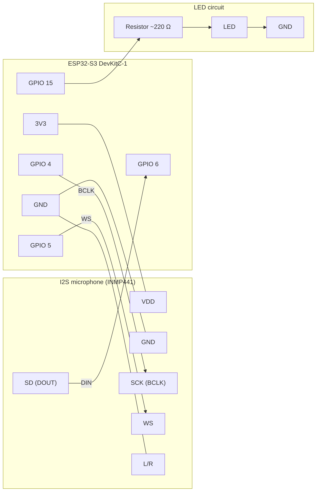
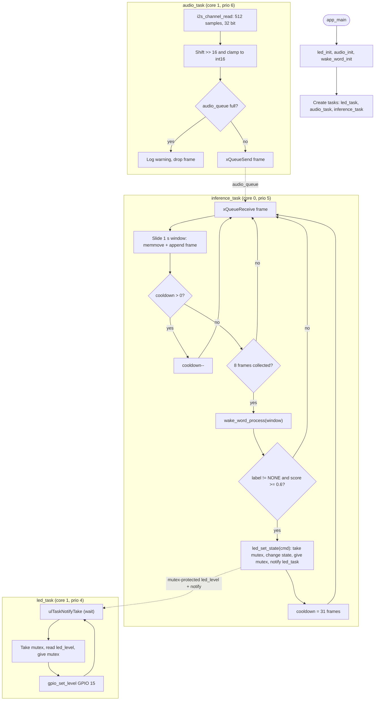

# M_6_9 — ESP32-S3 FreeRTOS wake word

Voice control of an LED on the ESP32-S3: an I2S microphone is sampled continuously, a 1-second sliding window is classified, and the result switches the LED on, off, or toggles it.

> **Status:** the Edge Impulse model (`components/edge_impulse`, keyword `carlos`) is integrated: saying the keyword toggles the LED. The old loudness stub is still available via `WW_USE_ENERGY_STUB` in `src/wake_word.c`.

## Hardware

| Part | Pin |
|------|-----|
| I2S mic BCLK (INMP441 / SPH0645 or similar) | GPIO 4 |
| I2S mic WS | GPIO 5 |
| I2S mic DIN | GPIO 6 |
| LED | GPIO 15 |

- Board: `esp32-s3-devkitc-1` (16 MB flash, 8 MB octal PSRAM).
- INMP441: connect L/R to GND (left channel). Audio is 16 kHz, 32-bit slot, mono.

### Wiring diagram



### Algorithm



## Build and run

Requires [PlatformIO](https://platformio.org/).

```bash
pio run                       # build
pio run -t upload -t monitor  # flash and open serial monitor (115200)
pio run -t clean
```

## How it works

```
mic → audio_task → audio_queue → inference_task → [mutex: led_level] → led_task → LED
      (core 1)                    (core 0)                    (core 1)
```

| File | Role |
|------|------|
| `src/audio.c/.h` | I2S setup; reads 512-sample (32 ms) frames, converts 32→16 bit, pushes to `audio_queue` |
| `src/wake_word.c/.h` | Classifier interface (`wake_word_process`) returning `WW_NONE/ON/OFF/TOGGLE` plus a score; currently the energy stub |
| `src/main.c` | `inference_task`: maintains the 1 s window, runs inference every 256 ms, 1 s cooldown after a detection |
| `src/led.c/.h` | `led_set_state()` changes the shared LED state under a mutex and notifies `led_task`, which reads the state under the mutex and drives GPIO 15 |

Inference runs on core 0 so it does not interfere with I2S reads on core 1.

## Updating the model

1. Export the C++ library from Edge Impulse Studio and replace `edge-impulse-sdk/`, `model-parameters/`, `tflite-model/` in `components/edge_impulse/`.
2. If the labels changed, update `WW_KEYWORD_LABEL` (and the label→command mapping) in `src/wake_word.c`.
3. Make sure `WW_WINDOW_SAMPLES` (`wake_word.h`) matches the model's input (checked at startup in `wake_word_init()`), and tune `WW_THRESHOLD`.
